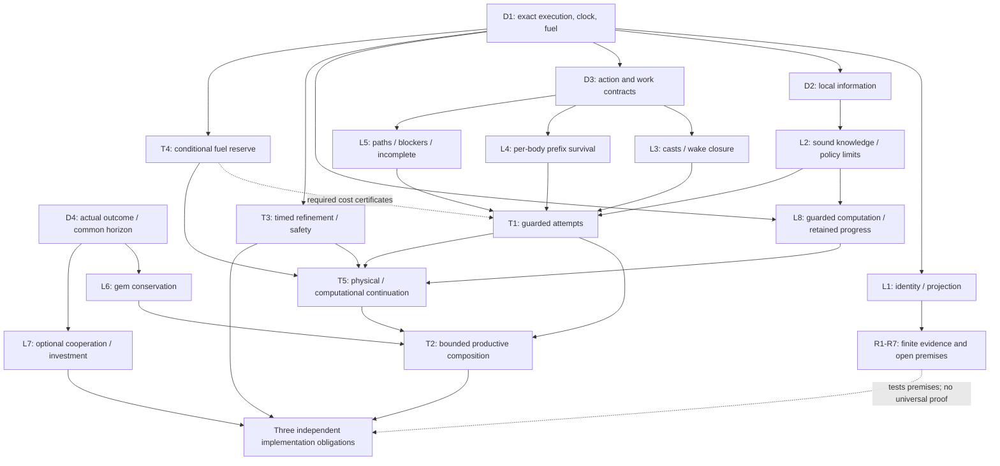

# Mathematics of the game and our controllers

This is the organizing core of the [foundation](README.md), not a claim that the game or a C++
bot has been solved. Definitions make the object precise; proofs say what follows from stated
premises; native evidence tests particular premises and executions. Each contender must supply
its own implementable answer. No main or anchor implementation source is required here.

Every statement carries one of four statuses:

| Status | Meaning |
| --- | --- |
| **Proven within model** | The conclusion follows from the explicit definitions and assumptions below. It does not prove the engine or a program implements those assumptions. |
| **Native premise** | A public contract or a source-bound native observation supplies a premise, with its own engine, inputs and coverage. One observed transition is not a universal law. |
| **Tested refinement** | A specified relation/projection agrees on listed finite executions. Unrepresented state, untested branches and arbitrary future executions remain outside the result. |
| **Open** | A required premise, implementation obligation, progress argument or strategic comparison remains unproved. |

These statuses qualify a result, not a mandatory development pipeline. A controller may use
an explicitly limited risk model and measured native outcomes while a stronger guarantee
remains open. `Unsupported`/`Unknown` must be passed to a deliberate executable continuation,
including declared risk where appropriate, rather than silently producing permanent idle.
The robust definitions below explain what a guarantee means; they do not require universal
hidden-state safety before every productive action.

## Definitions

### D1. Closed execution and time

Fix an execution identity `theta`: engine/runtime, settings, map, all compiled modules, PRNG/seed,
runner stopping rules and input scheduling. A closed state `x` contains:

- the world, scheduler, round/phase/actor and outstanding commands;
- every body's private VM memory, program counter, stack, execution status and remaining fuel;
- one writable **8-byte register per team**, and each team's **1024-byte draft data**, frozen in play;
- all relevant native numerical representations, including float32 bit patterns.

Write `x --[i,a,result,dt]--> x'` for a primitive transition. Queries, refused calls, errors,
yield, suspension and intervening actors are transitions too. `result` is not assumed to be a
successful effect. Keep the exact event clock `tau` (round, phase, owner/input/substep as needed).
For a horizon or cost sum, declare one elapsed-time coordinate throughout; a finite native-event
bound is additionally needed when multiple commands fit inside one round.

A recorded native API `input` integer is not necessarily an owner-turn identifier. In the
[ordinary Vesper compound](../../../results/contenders/timetable/independent/4a9db07ca948/local-prerequisite/micro-audit.json),
Basic/Reset/Basic/End use native inputs 494/495/496/497 while the same actor and phase continue,
with no owner end, other actor or volley between the three actions. Owner-turn-local history
such as an actual successful walk must follow the physical turn boundary; primitive input
numbers still locate events. Do not infer either four owner turns from those four integers or
one indefinitely valid turn merely from an unchanged actor/phase. The retained audit is an exact
selected-field transcription of a completed current-inspector window, not its original full
response bytes.

**Native premises:** [current rules](../../../docs/reference/GameRules.md), SDK and [M1-M3](mechanics.md),
[M48-M51](mechanics.md). Personal vision and own ward observations belong to a body; private VM
memory is not a public channel. A shared register is sequentially overwritten, not eight bytes
per body. Author, epoch, ownership and acknowledgment require an actual protocol.

### D2. Information and observation-consistent policies

Body `i` has history `h_i`: its draft data/private state, queries and command results with their
event times, and team-register values it actually read. A permitted controller chooses through
this history, `pi_i(h_i)`, rather than the full mathematical state. The model may represent the
full state without granting the bot access to it.

Let `B_i(h_i)` be a **nonempty** possible-state set containing the actual state. A proposition `P`
is certified by that information exactly when every `x in B_i` satisfies `P`. Observation,
prediction, reservation and verified acknowledgment have different types. An empty possible-state
set signals inconsistent premises; it never grants permission by vacuous truth.

An admissible scenario `omega` fixes a hidden initial world, environment resolutions and causal
opponent strategies. A paired policy comparison uses the same scenario set and opponents that
react to each branch's history, rather than a frozen tape of future opponent actions. Choosing
this scenario class is itself a modeling/risk decision, not a calibrated probability claim.
Every robust comparison declares a nonempty set `Omega` of those admissible scenarios.

### D3. Legal action transitions and work contracts

An action state includes movement/attack/cast allowances `(M,A,C)`, per-slot cooldowns, prior
movement/exclusive flags, live targets, status/channel, position and event epoch. Cooldown-ready,
geometric range, admissible attempt and guaranteed effect are distinct predicates.

A work contract `J` specifies an information/admissible-start set, an absolute deadline `H`,
required actual outcomes, a terminal predicate `T` and allowed environment continuations.
Its residual state includes HP, gear, liquidity, bags, positions, allowances, cooldowns, camp
HP/availability/timers, priorities, knowledge, memory and outstanding commitments. Partial camp
damage may persist through recovery. No operator silently resets these resources.

Robust feasibility means **one observation-consistent causal policy** meets the contract for
every declared admissible scenario. This is a useful conditional guarantee, not a requirement
that every bot accept only universally safe work under every imaginable world.

### D4. Reward and comparison

The actual game objective is first reaching the tribute threshold before the opponent; otherwise
the round-limit order is banked gems, lifetime gold, kills, then Team B on an exact tie. A stopped
local runner does not establish the complete terminal objective.

For a bounded comparison use `R_H(pi,omega)`: actual own banked gems by the same deadline, subject
to the same explicit terminal predicate `T`. Gold, damage, an intent and a clear are intermediate
states. Gold/items change feasibility; they are not silently converted into banked gems. Equal
bags or HP at a horizon do not establish equal future value: location, time, priorities, cooldowns,
resources, observations and opponent responses may differ.

## Lemmas

### L1. Identity and projection

**Proven within model.** If `theta`, initial state and a deterministic transition relation agree,
the complete primitive trace agrees. **Proof:** induction: equal predecessors and inputs give equal
next results/states. A version label or source key alone does not supply all these premises.

If projected traces `p(trace_1) = p(trace_2)`, only properties defined entirely by `p` transfer.
**Proof:** substitute the equal projection into that property's definition. Gameplay equality
does not imply equal fuel, private VM state or logging when those are absent from the projection.
Repeated deterministic keys are not independent observations.

### L2. Information limits and sound updates

**Proven within model.** Locally indistinguishable histories require the same action from a
deterministic observation-consistent policy. Conversely a rule constant on those equivalence
classes defines a history function. **Proof:** functionality, followed by defining the function
on each equivalence class. This converse proves neither computability nor finite-fuel implementation.

If two states in `B_i` disagree on `P`, that information cannot certify `P`. In particular,
`for every x there exists a feasible plan` does not imply `there exists one admissible policy
for every x`: indistinguishable worlds can require opposite first actions.

To update information, first propagate through **all** compatible intervening transitions:
`B_minus = Reach_U(B)`, then intersect with a fresh observation:
`B_plus = {x in B_minus : O_i(x) = o}`. Assuming the transition/observation models are sound and
no relevant event is omitted, the actual state remains in `B_plus`. **Proof:** its predecessor is
in `B`, its actual continuation is in `U`, and its actual query output equals `o`.

**Applications:** a disappearing capture intent need not be a payout; timer zero need not be a live
camp ([M52](mechanics.md#m52-capture-intent-and-expired-respawn-deadlines-do-not-prove-availability)).
A proved acknowledgment protocol could certify a payout, but presence or disappearance alone
does not. Same-round labels also fail to cover unmodeled own actions or suspension inside a call.

### L3. Cast packing and prospective wake closure

**Proven within model, conditional on the stated kit contracts.** If a successful cast changes
`C=1` to `C=0` and nothing replenishes `C` during the owner opportunity, every legal prefix contains
at most one successful cast. **Proof:** the monotone Boolean resource can be consumed only once.
A reset therefore competes with a shield or stun. For a kit requiring a spent attack, a refused
basic that leaves `A=1` has not established reset's `A=0` precondition. The
[U10](micro.md#u10-a-refused-basic-does-not-make-ryths-reset-legal) Ryth observation tests one branch;
it is not a universal reset-kit contract.

Let `D` be members actually damaged by a proposed action, including splash/AoE, and suppose
`D subset D_hat`. Then `union group(D) subset union group(D_hat)`.
**Proof:** every damaged member belongs to an included group. A threat forecast must cover that
prospective wake set, the old awake set, every still-live sibling and the post-move position
before the next automatic camp phase. This set inclusion alone supplies no numerical damage bound.

### L4. Individual survival is a prefix property

**Proven within model.** Let `h_i(k)` be body `i`'s exact HP after event prefix `k`, using ordered
native mitigation, expiry and healing. It can perform every required later action only if it
survives every preceding lethal boundary. If `U_i` bounds the **maximum prefix cumulative net HP
loss** before its next safe decision, `HP_i > U_i` suffices for survival over that interval.
**Proof:** each prefix leaves HP at least `HP_i-U_i > 0`.

Terminal net loss is insufficient: HP5, damage10, later nominal heal20 dies before that heal.
Pooled HP is insufficient too: `(10,1000)` facing unavoidable damage `(20,0)` loses the first body.
Future priority/ability writes cannot rescue damage that precedes them. A shield success, a
nearby helper or a historical DPS rate does not prove `U_i`. Float32/rounding and expiry must be
covered by a sound bound; team safety needs the obligation for every relevant body.

### L5. Paths, blockers and incomplete searches

**Proven within model.** In one frozen ordinary-movement graph, assume fresh observed blockers
are a subset of true blockers, with the same terrain/forbidden-goal conventions. Then
`G_true subset G_observed subset G_terrain`, hence
`d_terrain <= d_observed <= d_true`, allowing infinity. **Proof:** removing vertices cannot add a
shorter path. This is not a future dynamic-arrival bound; blockers can move and allowances compete.

On a fixed graph with exact integer distance, suppose that while distance is positive a successful
legal decreasing step remains available and the controller continues taking such steps. It reaches
a zero-distance goal after at most the initial distance many successes. **Proof:** `d_n <= d_0-n`.
This counts successful steps, not elapsed rounds, failed attempts or fuel deferrals; a prefix that
stops before the goal does not prove arrival.

A bounded search that has not visited a point proves **incomplete**, not unreachable. A refused
move refutes that attempted transition, not every route. Frozen disconnection needs an exhaustive
search or a proved cut covering every movement edge actually in scope. A unique landing blocker
is not automatically a whole-group-death cut. The corrected [P5/P6](maps.md) distinguish these
claims, live occupancy and unmodeled kit movement. Reaching an altar's spatial frontier also does
not establish bag, lock/channel legality or eventual score conversion.

### L6. Gem-flow accounting

**Proven within model.** Event-index own carried gems `C_n`, banked gems `B_n`, actual nonbank
credits/debits `i_n,o_n >= 0` and bag-to-bank conversions `b_n >= 0`. Assume these exhaust the
changes and internal transfers cancel in team totals:

`C_(n+1) = C_n + i_n - o_n - b_n`, `B_(n+1) = B_n + b_n`.

Then `B_H-B_0 = C_0-C_H + sum(i_n-o_n) <= C_0+sum i_n`.
**Proof:** add the identities and telescope. Actual rounding/split losses and theft/death flows
must be represented; do not substitute nominal group reward for actual credits. Capture-before-
tribute matters through exact event order. Native event/bag/score joins test the accounting;
clear, damage and intent are not credits merely because their names suggest progress.

An actual receipt does not require our team to own the final-clear credit.
[BigWorld A's current native account](../../../results/contenders/native-evidence/mosaic-lean-r2-bigworld-a-production.json)
has zero own clear credits yet 228 gems received and banked, plus unallocated own monster damage.
Capture control, last-hit attribution and economic activity are different observations; neither
exclusive enemy labor nor recurring own service follows from that single lost-game conversion.

### L7. Optional resources, cooperation and investment

**Proven within model.** With identical initial resources, information, objective, opponent class
and horizon, restrict both policy classes to feasible causal policies meeting the same terminal
predicate `T` in every declared scenario. Assume `Pi_I` is nonempty. If independent policies
`Pi_I subset Pi_C` where cooperation is optional, then
`sup_(pi in Pi_C) inf_omega R_H(pi,omega) >= sup_(pi in Pi_I) inf_omega R_H(pi,omega)`.
**Proof:** a supremum over a superset cannot decrease. Forced recruitment, a changed draft or a
particular implemented policy need not satisfy that inclusion or attain either supremum.

Requiring a legal purchase prefix `q` restricts the unrestricted feasible initial policies; it
does not enlarge them. **Proof:** every `q`-then-suffix policy was already an allowed optional
policy. Buy-versus-keep *post-prefix* states can have incomparable feasible continuations because
time, liquidity, HP, readiness and location differ.

For two specified causal policies under the same scenarios and terminal predicate, pointwise
`R_H(buy,omega) >= R_H(keep,omega)` establishes weak finite-horizon bank dominance.
**Proof:** substitution in each scenario. Strictness in one world is only possible advantage;
expected strictness requires a probability assigning it positive mass. This is not a comparison
against the best possible keep policy. Purchase travel/time and subsequent useful work belong in
the contract; higher stats or a high spending ratio alone prove no controller improvement.

### L8. Guarded computation and retained progress are different

**Proven within model.** At service visit `t`, let available fuel be `F_t`, the preceding prefix
cost `O_t`, and admission require `F_t-O_t >= B`. Suppose this predicate fails on every visit,
the only service-progress transition requires admission, and deferral leaves its progress state
unchanged. Then the service never progresses. **Proof:** induction on visits; each takes the
unchanged-state branch. Retaining a job identifier alone does not break this fixed point.

For a fixed generation, instead let retained progress be an integer `0 <= p <= N`, never
decreasing, with **service complete if and only if `p=N`**. All validation, publication and tail
work must be included. Suppose from every unfinished state a completed unit increases `p` by
at least one within at most `W` further eligible owner inputs. Conditional on the generation
remaining fixed and play supplying those inputs, completion takes at most `W*(N-p_0)` inputs.
**Proof:** induction on the remaining rank `N-p`; each unit reduces it and costs at most `W`.
Eventual admission/completion without `W` supplies no finite-horizon bound. A cursor reaching
the last row while final publication never fits does not satisfy the completion premise.

Immutable work can be reused within its declared generation. Pure work on mutable data may
also persist as dated input, with later validation or a sound uncertainty model; persistence
alone does not make it current authority. A mixed-epoch packet need not describe any real world:
one blocker starts at B, we read A empty, it moves to A, then we read B empty. The assembled
both-empty packet was never true. **Proof:** enumerate those two world states. L2's transition
closure and T1's actual command-boundary premises are still required.

A finite search may terminate with an unresolved or negative model result while the physical
service remains unfinished. If the enclosing controller then waits only for a world change
unrelated to resolving that result, the cursor's termination supplies no productive liveness.
Mosaic's [sampled R300 diagnostic](../../../results/contenders/mosaic/interpreter-r1/diagnostic-r300/index.json)
records exactly an exhausted family, unchanged graph and retained `unknown_wake` support.
Its [R2 full-game application](../../../results/contenders/mosaic/support-bound-r2/index.json)
separately establishes later repeated quiet-class team production after a restricted model
repair. These are finite source-bound observations, not a theorem that all unknowns are zero
or a unique causal comparison. Static nonattacking bounds can answer an incoming-damage question
without certifying life, target availability or effects. Preserve those predicates separately,
then choose a resolving operator, another complete family or a declared risk continuation;
`Unknown` is not physical infeasibility or a complete controller terminal.

## Theorems and their implementation obligations

### T1. Guarded attempts preserve a declared invariant

**Proven within model.** Suppose `B` is nonempty and sound at the actual command boundary, and
the outcome relation for attempt `a` satisfies `R_a(B) subset I` for **every** compatible success,
refusal, error, suspended/interleaved or unchanged-position result. Then the actual result lies
in invariant `I`. **Proof:** actual predecessor belongs to `B`; its result belongs to `R_a(B)`.
This proves result-boundary safety. If an attempt summarizes several events, an invariant
throughout the attempt additionally requires coverage of every intermediate prefix, or a history
state recording any violation; endpoint recovery cannot erase an earlier unsafe prefix (L4).

A separate sound `PreSuccess` certificate can rule out refusal only under its complete legality,
fuel and no-interleaving premises. Planned escape must otherwise cover remaining exposed after a
blocked move. Query/readiness/epoch checks must precede the observations they certify and remain
valid to action linearization, or use L2's intervening-transition closure. A later fence detects a
stale effect; it cannot prevent or undo it. This theorem neither proves a productive action exists
nor prescribes an always-conservative work admission policy.

### T2. Complete-production contracts compose

**Proven within model; current controllers have not discharged these premises.** Let residual
history sets `R_0,...,R_k` and one observation-consistent operator `P_j` per stage satisfy:

1. For every admissible start in `R_j` and every allowed environment continuation, `P_j` wins
   immediately or reaches `R_(j+1)` with guaranteed actual bank gain at least `g_j >= 0`.
2. Each operator terminates within finite native-event bound `N_j` and elapsed bound `L_j`, in
   the same horizon coordinate. No opponent terminal win occurs under the declared assumptions.
3. Approach, actual action transitions, individual survival, recovery, reward/conversion, helper
   release, turn fuel and all residual resources/knowledge satisfy the next operator's preconditions.

Starting at clock `t_0`, composition wins early or reaches `R_k` within `sum L_j` elapsed time and gains at least
`sum g_j` banked gems. **Proof:** induction on operators; postconditions supply the next
preconditions, finite bounds prevent nontermination, and L6 telescopes the gains.
If `t_0+sum L_j <= H` and the gain reaches the remaining winning threshold, this proves the stated
horizon win under all those premises. The no-earlier-opponent-win premise needs its own bound
or explicit restricted opponent class; without that, this is a continued-play production result,
not an adversarial winning guarantee. An abort outside the promised postcondition revokes this
conclusion; it needs a separately contracted zero-gain recovery/abort operator. A single observed
cycle proves existence of that execution, not universal feasibility, renewal or strength.

### T3. Refinement transfers only the properties it represents

**Proven within model.** Let `R(c,m)` relate concrete execution states to model states. Suppose
initial states relate and, **for every currently related pair** `R(c,m)` and every concrete branch
`c --> c'`, a model path starts from **that same `m`**, matches the declared action/result/time
labels and ends at an `m'` with `R(c',m')`. Induction composes these diagrams over
every finite concrete prefix. If concrete bad states imply related model bad states, a proved
model safety invariant transfers to concrete executions.

Only steps preserving the declared observables **and elapsed time** may be hidden as stutter.
Unbounded stutter or finite-prefix safety alone proves no eventual bank/renewal/win; progress
needs T2's bounded contracts, a well-founded ranking or another divergence-sensitive argument.
Forward overapproximation can justify safety while still admitting impossible attractive plans;
planning also needs a causal realization argument for the selected path.

A useful current application is ground-center deduplication. Equal hit masks over a supplied
eight-target set can define a quotient of that restricted stationary successor model. They
do not establish native successor equivalence: two independently legal centers may hit different
omitted or hidden camps, wake a different group, or hit a Ren omitted from the mask and trigger
immediate retaliation. A native-equivalence claim must represent all possible affected support,
relevant statuses/effects and ordered responses, not only counted damage. Current free-floor
center witnesses and range-only proposal masks do not establish arbitrary center legality.
Ryth has no known persistent ground field in this class; do not invent one to justify the
qualification. This is an application of the represented-property rule, not a new native
experiment or an additional gate before testing a limited-model controller.

**Open:** universal controller-to-engine refinement. Nonexhaustive finite agreement cannot prove
it: an alternative model can agree on every tested state/action and differ at an untested allowed
pair. Exhaustion of a proved closed finite domain or an independent structural proof would be
needed. Native traces below are calibration/witnesses, not such an exhaustive proof.

### T4. A fuel reserve is a conditional cost theorem

**Proven within model; numerical certificates remain open.** At a checkpoint suppose reported
fuel `r` overstates actual remaining fuel by at most `E`; guard tail costs at most `g`; admitted
segment costs at most `C`; and every cleanup/error-log/yield suffix costs at most `K`. With enough
fuel to obtain the read, `r >= E+g+C+K+1` prevents exhaustion in that segment and suffix.
**Proof:** subtract the certified upper bounds in order; at least one unit remains throughout.
All host costs, exceptions, destructors, allocation and logging paths must be covered.

A loop with decreasing bounded variant, at most `N` iterations, body cost at most `c` and
entry/exit cost `h` has cost at most `h+N*c`. **Proof:** induction on the variant. A radius cap or
sampled per-layer fit is not a native host-cost certificate. Reads and guards themselves need
earlier coverage. Builds, sampled peak fuel and a post-work clock fence do not prove this theorem's
premises. Suspension inside a query/action is a timed execution transition under D1/T3.

The [native planner component measurement](../../../results/contenders/mosaic/lean-word/fuel-r1/assessment.json)
makes the entry-cost term concrete. In two deliberately truncated 25-round Packs self-games,
the prior search call with zero expansions costs 43,223 fuel for an empty fixture and 46,454
for eight targets. The compact active-length counterpart costs 964/4,196; one eight-target
node costs 5,893 and eight nodes 18,037. Three measured full 32-node/eight-target hot fixtures
cost 53,284-57,543. A node limit alone therefore did not cover validation, workspace setup,
copying and result consumption before/around expansion. The separately measured scalar fixture
assembly and logging are outside that search bracket.

Only nonnegative deltas with the producer's pre/post epoch equality are admitted; suspension
deltas are rejected even when their subtraction looks positive. The broader 32-target/32-node
compact fixture still suspends. Finite checksums agree for the supplied fixtures, not arbitrary
native worlds. Neither 25-round probe has full exported statistics or whole-probe health
qualification, and these are measured caller costs rather than universal upper bounds. Full
controller collection, navigation, dispatch and ordinary-game health require their own evidence.

### T5. Computation must refine the physical continuation

**Proven within model; current implementations have not discharged the premises.** A yielded or
suspended input that leaves a body exposed is a physical waiting continuation. If it admits
intervening hostile opportunities, a survival bound priced for `m` such opportunities does not
by itself cover `m+d` after computation deferrals. **Proof by counterexample:** HP 25 with a
20-damage hit survives one opportunity but dies on the second. A finite attack/return trace
places no bound on the number of inserted deferrals. Clock-changing waits also cannot be
erased as time-preserving stutter in T3.

For a staged implementation, assume L8 supplies a completion bound before the contract deadline,
with finite native-event bounds and a declared conversion to T2's elapsed-time coordinate;
every actual compute/wait/action prefix, including allowed interference, is covered by L4's
survival bound and T1's outcome relation; and selected action authority remains sound through
its effect. Then those stages supply the computation, physical safety and time premises of the
corresponding T2 operator. **Proof:** L8 bounds service completion, L4/T1 cover each actual prefix
and command result, and the declared conversion bounds elapsed time. Actual reward and the next
operator's residual postcondition remain separate T2 obligations. This is a conditional
composition rule, not a claim that a useful operator exists.

A pre-query epoch check alone does not prove authority at effect: an allowed suspension can
separate it from the query or dispatch. Adding finitely many checks leaves a final check-to-effect
suffix. Sufficient routes include an appropriate atomic host validation/dispatch contract;
T4-certified cost for the entire suffix **with exclusive owner execution and no other relevant
interleaving**; or L2/T1 closure that safely covers every compatible intervening transition and
outcome. A later check cannot undo an earlier stale effect. Cheap guards or empirical reserves
alone establish none of these routes. Preparation in a proved quiet state, priced bounded
exposure, or a separately guaranteed cheap continuation are possible designs; sleeping camps
or current zero damage alone do not prove quietness under future wake/expiry or enemies.

**Conditional one-refusal path bound.** Let prescribed retreat positions be `p_0,...,p_L`,
`L>=1`, with quiet terminal `p_L`. Each successful leg occurs before exactly one following
charged phase at its destination. Assume the only loss is nonnegative HP loss bounded by a
fixed `D(p)` uniformly at every occurrence, with sound numerical bounds and no healing credit.
With all legs successful, `B=sum_(i=1..L) D(p_i)` bounds loss. Suppose at most one leg refuses,
leaves the body at its origin for one extra charged phase, then that same leg is retried
successfully and every remaining leg succeeds. Total loss is bounded by
`B + max_(i=0..L-1) D(p_i)`. A separate work wait at `p_0` adds another `D(p_0)`.
**Proof:** a refusal at origin `p_i` inserts exactly that one additional charge into the same
successful-phase sequence; maximize over origins. Nonnegative charges make this total dominate
every prefix, so initial HP strictly above the complete bound implies L4 survival in this model.
The cheaper `B+D(p_0)` covers a current-origin refusal alone, not one anywhere unless every
later possible refusal origin has `D(p_i)<=D(p_0)`. A quiet origin, hazardous intermediate and
quiet terminal refute that shortcut. Extra computation waits, further refusals, changing damage,
external losses or unavailable future legs invalidate these premises; no SDK timing, path
availability, executable fuel or productive-return theorem is supplied by this algebra.

**Conditional full-spawn recovery.** Fix finite constant maximum HP `H>0`, a uniform per-batch loss
bound `0<D<H`, and initial HP `h_0>D`. Before each next damage batch, a living body receives
its physical owner-turn-end recovery while still on its own spawn. Assume exactly one priced
batch between recoveries, nonnegative loss at every batch prefix totaling at most `D`, and
queried runtime healing fraction `alpha=1`, which resets living HP to `H`. No foe, displacement,
unpriced loss/batch, max-HP change or computation-issued invalidating action is admitted; loss
and healing bounds must cover native numerical effects.

Then it survives every prefix of every finite number of these turns and returns to `H` at
each recovery. **Proof:** in the first batch every prefix leaves at least `h_0-D>0`; recovery
gives `min(H,h+H)=H`. Induct: the next batch leaves at least `H-D>0` and recovery again gives
`H`. Positive potential damage therefore need not prohibit retained computation on spawn.
Death before recovery, initially insufficient HP, a different healing fraction or multiple
unpriced batches invalidates this argument. In general the recurrence is
`h_next=min(H,h-loss+alpha*H)`, only after proving survival of every intervening prefix.
The [retained public-rule derivation](../../../results/contenders/foundation/spawn-healing/lemma.json)
uses a pinned default of 1.0 without a fresh settings query; runtime settings remain a premise.
This is neither fuel health, coherent retained authority, useful progress nor safety against
foes. Cumulative incoming/healing totals do not locate a body or prove this recurrence for an
actual champion; in particular they do not establish the cause of 8ff Vesper's observed totals.

## Results and unresolved premises

These rows do not promote a controller. Native observations supply finite premises; mathematical
proofs above explain what additional obligations would permit a stronger conclusion.

| Result | Status and exact scope | What remains open |
| --- | --- | --- |
| R1: current Ryth refused basic/reset ([U10](micro.md#u10-a-refused-basic-does-not-make-ryths-reset-legal)) | **Native premise:** one constructed engine 1.0.3 branch refuses an out-of-range basic, retains attack, then refuses a spent-attack reset. | Other kits, normal frequency and universal action-model refinement. |
| R2: party execution and final gameplay transfer ([E31](economy.md#e31-next-round-priority-rotates-a-single-elks-tank-without-losing-either-melee-basic)) | **Native premise:** conditional priority lab and two autonomous payout/statistics-bank suffixes. **Tested refinement of the declared gameplay projection only:** all 16 complete payloads agree between the specified traced/final untraced versions; private/fuel state is excluded. | Useful displaced labor, naturally useful below-half-health continuation, renewed production and strength; eight paired keys are null. No universal controller/model refinement follows. |
| R3: death-free throughput failure ([G11](strategy.md#g11-useful-production-is-a-complete-observed-conversion-chain)) | **Native premise:** one matched `01big-world` A/v42 key through round 400, no subject deaths in either arm, collected/banked 240/133 versus 33/33. | The private original task/quote and one causal defect; survival is insufficient to establish supply. |
| R4: dense task and cast trade ([U11](micro.md#u11-dense-geometry-changes-actual-work-while-the-single-cast-still-prices-shield-against-reset)) | **Native premise:** four corrected 180-round constructed cells, twelve complete windows; specified Varg/Ryth executors clear/capture 16 gems/bank at rounds 69/116 on both sides. Four 40-damage hits from one Varg basic; shield/reset compete. No abstract model trace was compared. | Ordinary selection/health, model refinement, opportunity value, optimal kit, architecture strength and renewal. Traced r1 at-budget health failures remain separate. |
| R5: one initial altar-neighbor blocker ([P5/P6](maps.md)) | **Native premise from pinned static data:** camp 20 at (24,20) is the sole terrain-legal BossBattle altar neighbor; group has two monoliths/400 gems. | Current one-member death/landing/tribute with its companion alive; special-kit reachability and exclusive bank control. Whole-group-first-capture 103 remains conditional model output, not a proved engine lower bound. |
| R6: ordinary kernel health failure ([Mosaic ordinary index](../../../results/contenders/mosaic/ordinary/index.json)) | **Native premise; ordinary health FAILED:** final ON `c37202593e0d`, eight full games on two pool maps/both sides/v44 and starter, reports 142 exhaustions and eight error lines; corresponding OFF `97cdf5150e14` has eight technically healthy games. | **Open:** T4 cost certificates, totality and T3 controller refinement. Source repetition is observed, but native query multiplicity, charged call site and a unique exhaustion cause are unmeasured. The four lab cells cannot discharge these obligations. |
| R7: computation versus physical progress ([G11](strategy.md#g11-useful-production-is-a-complete-observed-conversion-chain), [U11](micro.md#u11-dense-geometry-changes-actual-work-while-the-single-cast-still-prices-shield-against-reset)) | **Native premises:** frozen Mosaic R13 is technically clean on one Yellow Brick Road A key but stalls; a separate profile remains incomplete. Timetable `991300eec8d0` has 1,470 partial outgoing HP, no reward, and a stationary ready Ryth killed by camp attacks after nearby ally work. Warband's frozen 14-game keeper fails health despite clean short prefixes. | L8/T5 progress, fresh authority, bounded physical waiting and complete conversion remain **Open**. These executions do not identify private no-op branches, prove universal cost bounds or establish causal cooperation/strength. |
| R8: complete harmful-service model ([conditional policy](../../../results/contenders/coverage-atlas/harmful/index.json)) | **Proven within the declared finite model; not native-verified:** one YBR/base-Vendetta group policy covers all 16 modeled recall landings, banks four gems, retains 80 earned gold and ends at full 1,000 HP on spawn; at most 80 physical inputs include one refused move and one compute wait globally. | Actual native state/legality, all hostile support, uncontested reward, uninterrupted recall/free landing, owner-end healing, deadlines, finite-fuel dispatch and controller refinement. The 296 composition candidates on 32 maps are not feasible-service coverage. |
| R9: later source-bound production applications ([G11](strategy.md#g11-useful-production-is-a-complete-observed-conversion-chain)) | **Native premises:** Mosaic quiet-service R2 `42d9a229b207` banks 210/242 on two full Packs/passive sides, with quarter and last-event audits showing late team production; Varg retains long loaded no-work suffixes. Independent Warband SERVICE `d01adcbc055d` banks 784 on one full Packs A/passive key, including 224 after round 1500; its selected Ryth is full-ready outside spawn and resumes work. | All-actor and harmful/pressured renewal for Mosaic; actual spawn/required-shop completion for the selected Warband service; useful cooperation and competitive strength for either. Later source changes do not inherit these frozen results. |
| R10: partial work, recovery and conversion ([native application](../../../results/contenders/coverage-atlas/two-harmful/native-continuation/assessment.json)) | **Native premises:** on one YBR/group8/base-Vendetta execution, a partial kill precedes actual spawn healing, remaining work, 15-gem capture, loaded recall, actual healing, banking and full-HP spawn renewal. An official branch from the retained round34 state executes 128 audited primitives and one actual recall landing. | The initial probe's observation-guard error remains preserved. Its suffix is host-controlled, not a deployable WASM controller or fuel proof. The other 15 modeled landings, interference, repetition and strength remain open. |
| R11: a finite economic class misses a measured pace ([deadline join](../../../results/contenders/throughput-bounds/deadline-join/assessment.json)) | **Proven within Q0 plus native reference premises:** the optimistic harmless-source-only supply bound is below 1000 at opaque main's measured passive deadline on 67/80 pool/side keys, including 46 with no such source. Packs A has ceiling 952 at round 844 even with free work and delivery. | This is an isolated class limit, not a head-to-head loss theorem: interaction may delay main. Stat changes do not create harmless-group supply. Harmful-source and champion-gem operators are outside Q0; passing an upper bound is not a feasible service. |
| R12: Heart response and actual owner horizon ([U12](micro.md#u12-damaging-heart-can-strengthen-its-next-response-and-one-disabled-input-is-not-safe-renewal)) | **Native premise:** one actual equipped Marcella/Heart root, 675 finite declared prefixes and 1,926 retained-evidence checks; the one-input stun expires before Heart's second opportunity, and six HP of prior damage raises its later two-hit raw response by about 0.702. | Complete adversarial coverage, other actors/hidden ingress, observation-safe deployment, fuel, conversion, renewal and competitive value. No accepted endpoint changes score. |

No exact deterministic abstract projection is justified merely by omitting fuel: equal projected
world/allowances can in principle admit immediate completion or suspension with different timed
successors. A projection defines a deterministic exact transition only when the represented next
outcome is constant across every concrete state in each projection class. The r1/r2 Mosaic fuel
observations motivate this obligation; their different binaries do not themselves exhibit an
identical-projection counterexample pair.

The [frozen kernel-cost evidence](../../../results/contenders/mosaic/kernel-cost/index.json)
discharges a concrete *failed* T4 premise: on constructed typed 30-task/160-world-member inputs,
one selected primitive costs 22,863-42,385 fuel before SDK collection, navigation and actuation;
Ryth-shaped menu enumeration costs 1.754-1.777 million, or 347,938 with eight candidates. Even its
nine-member menu exceeds 100,000. These measurements bind frame `64764181...` and transition
`08ea0a48...`, not a forthcoming optimized implementation. They are neither universal upper
bounds nor reachable native-world certificates. Finite charged execution is part of an
executable action contract; C++ purity or termination alone does not establish T4.

The separate [native collector probes](../../../results/contenders/mosaic/frame-observation-cost/index.json)
measure actual 24-group/92-member BigWorld A observation with both teams waiting. Baseline
`34a7b132222b` has three exhaustions at roughly 68-72k steady collection; persistent-buffer
`842525e9d6ab` has zero faults/errors/exhaustions in one full 2,000-round cell at roughly 49-52k.
The latter still returns incomplete at startup. This establishes only that cell's collector
health, with profiling included; neither combined-pipeline totality nor a universal bound follows.
Different source/state measurements cannot be summed into a certified T4 cost.

## Applications to three independent contenders

These are proof obligations at actual implementation boundaries, not proofs of these files.

A finite constructive application now exists in [M28](mechanics.md#m28-dashes-chebyshev-ability_dashrange-2-over-holes-not-through-walls-onto-free-ground):
one controlled current-engine Vesper trace completes harmless member work, same-input basic/dash,
capture concurrent with delayed recall, actual 21-gem bank and a fully ready spawn endpoint.
The independent saved-history audit fixes payout before recall arrival, not merely same-round
labels. This is one realized physical operator under fixed geometry/passive/no-interference
premises. It supplies an existence witness relevant to D3/L3/L6/T2, not T2's universal operator
contract, L8/T5's general controller progress or a second cycle. Truncated aggregate/fault/
exhaustion zeros are unavailable; prefix logs and fuel samples are the bounded health evidence.

### Conditional complete harmful-service application

This is an application of T2/T5, not an additional engine axiom. Fix one body, a positive-gem
group and a nonempty, sound information set. Suppose observation-consistent operators establish
ingress, harmful-member removal, remaining member work, actual clear/capture/receipt, a loaded
recall, actual arrival and owner-end recovery, a landing-specific bank, and the required final
renewal predicate. Each operator must preserve every later precondition, cover all actual damage
and action prefixes, and finish within declared native-event and physical-time bounds. Refused
attempts and compute waits consume explicit finite delay allowances; they do not reset progress.

Recall additionally requires an uninterrupted channel and a free own-spawn landing. Branch on
the actual observed landing and automatic completion, credit neither a second fictional arrival
nor a heal before its living owner-end event, and cover every admitted landing. After recovery,
restore every threat/occupancy whose absence is no longer guaranteed; the bank and return need
their own finite exposure and legality certificates. Current full HP elsewhere is not the same
terminal predicate as full-ready at spawn. A shop stage is required only when the stated
contract requires it; a bank, cash balance or potential purchase is not observed investment.

Under these assumptions, compatible finite bounds within the deadline, and continued play or
T2's no-earlier-opponent-win premise, composition banks the certified gain and reaches the
specified renewal state. **Proof:** each validated stage supplies the next residual contract;
T1/L4 cover attempts and every physical wait, L8/T5 bound progress without erasing time, and
T2/L6 compose termination and actual bank credits. This guarantee no longer follows if a required stage
aborts outside its postcondition, a delay allowance is exceeded, or an automatic event is
mistaken for a nominal tape index.

The [audited harmful policy](../../../results/contenders/coverage-atlas/harmful/index.json),
SHA `01d94e2724693aaf739eaf4285e9f676fc9d59361a3e20e786006bece579b420`,
is one constructive **model** application of this complete word. Its reserved HP lower bounds
are 260 before recovery and 860 on the priced post-heal suffix. It assumes fresh native
realization of its inputs, one harmful member with harmless satellites, no unmodeled external
intervention, and queried `spawn_healing=1`; it supplies no measured WASM cost bound. Loaded
recall and finite priced banking therefore enlarge the represented conditional menu without
proving native applicability, repeated-cycle value, a universal safe service or strength.

| Contender and code boundary | Mathematical object to implement | Required check and next discriminating result |
| --- | --- | --- |
| Timetable: independent retained-service [notes](../../contenders/timetable/NOTES.md) | Distinguish owner-turn history from primitive input timestamps; refresh actual post-effects and make unsupported/negative work choose an enabling continuation. L2-L5/L8/T1/T2/T5 qualify declared risk, not universal safety gates. | Selected refresh source4a9 banks 242 with 13 clears on one full YBR/passive key with an actual Vesper Basic/Reset/Basic word and later Ryth renewal. Frozen314 DIRECT loses both YBR/v44 keys 55/17; its four world payloads equal b7 and add no strategic coverage. Later-source/all-five/strength qualification remains separate. |
| Mosaic: fresh lean action-word [notes](../../contenders/mosaic/NOTES.md); staged predecessor [notes](../../miscellaneous/mosaic-guarded-perch-service/NOTES.md) remain retired | Price whole search setup plus expansion, collect residual life/effect authority, and keep capped target-mask quotients within their represented support. L2-L5/L8/T1/T3-T5 qualify a limited model; concrete enabling continuations still matter. | Lean-r2 a353 wins one Packs B/passive game 1012/37 with 406 harmful-source gems and all three actors producing late, clean measured technical health. Component probes, driver/consumed-role limits, Ryth middle inactivity and later source changes remain separate; the six main losses and own E44 errors fail cohort qualification. |
| Warband: capital/cooperation [notes](../../contenders/warband/NOTES.md) | Separate dead lifecycle from live-info availability, unknown from dead, and historical HP from fresh work. A rolling word still needs complete charged cost and a concrete continuation when unsupported. L2-L4/L6-L8/T1-T5 apply within the stated local risk class. | Rolling d8 RAW produces 55 banked with all five doing actual work on one YBR/passive key but 59 exhaustions and incomplete context fail measurement. Earlier capital native support and four main losses retain their own sources. Neither another role nor a cached-field successor inherits health/strength. |

### Dependency graph

Next proof work should close a concrete missing premise in this graph or falsify it. Another
scalar fit, a healthy build, an isolated applied ability or a replay-identical rerun does not
replace an information, legality, time, fuel, progress or opportunity-value proof obligation.
